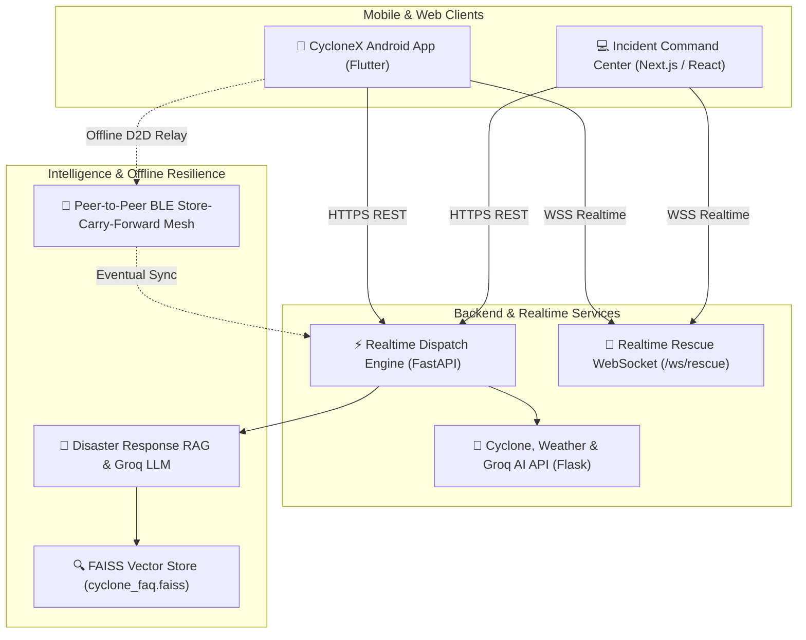

# CycloneX — Intelligent Cyclone Monitoring & Emergency Rescue Coordination Platform

[](https://github.com/Prastut08/voidx/releases)
[](https://github.com/Prastut08/voidx/releases/latest)
[](https://github.com/Prastut08/voidx/actions)

---

## 📱 Android Application Download & Release

Get the official **CycloneX** Android build directly from GitHub Releases:

- 📥 **Direct APK Download**: [Download Latest APK (`app-release.apk`)](https://github.com/Prastut08/voidx/releases/latest/download/app-release.apk)
- 📦 **GitHub Releases Page**: [View All Releases & Assets](https://github.com/Prastut08/voidx/releases)
- 🏛️ **GitHub Repository**: [https://github.com/Prastut08/voidx](https://github.com/Prastut08/voidx)

### Android Installation Instructions:
1. Tap the **Direct APK Download** link on your Android device (Android 6.0 / API 23 or higher).
2. Once the download completes, tap the notification or open your device's **Downloads** folder.
3. If prompted with *"For your security, your phone is not allowed to install unknown apps from this source"*, tap **Settings** and enable **"Allow from this source"**.
4. Tap **Install** and open **CycloneX**.
5. Grant **Location** and **SMS / Notification** permissions on first launch to ensure real-time emergency dispatch and offline emergency relay functions correctly.

---

## 🌊 Overview

**CycloneX** is a mission-critical cyclone monitoring and emergency rescue coordination platform engineered to save lives before, during, and after severe weather disasters. It bridges citizens in distress, multi-agency volunteer rescue teams, and centralized disaster command centers in real time—even when grid power and cellular communication infrastructure collapse.


---

## 🏛️ System Architecture



---

## ✨ Key Features

- **Real-Time Cyclone Tracking & Meteorological Analysis**: Live Doppler radar, forecasted cyclone storm paths, wind radii swaths, and categorized threat zones.
- **One-Tap SOS Emergency Dispatch**: Instantly creates prioritized distress alerts with exact GPS coordinates, severity classification, and headcount.
- **Bi-Directional Rescue Responder Network**: Live dispatch feed via WebSocket (`/ws/rescue`) connecting field volunteers with victims based on Haversine geographic proximity.
- **Offline Store-Carry-Forward Emergency Mesh Relay**: Native BLE companion module allowing disconnected devices to queue and bounce encrypted SOS packets across local peer nodes until connectivity is restored.
- **AI Emergency Safety Assistant & RAG**: On-demand safety protocols, evacuation guidance, and immediate first-aid instructions powered by FAISS vector embeddings and Groq LLMs.
- **Verified Nearby Emergency Resources**: Discover nearby 24-hour pharmacies, medical relief camps, food distribution centers, and shelters with instant call and route capabilities.

---

## 🛠️ Technology Stack

| Tier | Technologies |
| --- | --- |
| **Mobile Application** | Flutter (Dart), Android SDK (API 23–34), Kotlin, Android BLE APIs |
| **Web Responder Dashboard** | Next.js 14, React 18, TypeScript, Tailwind CSS, WebSockets |
| **Backend & Realtime Engine** | FastAPI, Flask, Python 3.10+, Uvicorn, WebSockets |
| **AI, RAG & Vector Search** | FAISS (`cyclone_faq.faiss`), Sentence-Transformers, Groq API (`qwen/qwen3.8-27b`) |
| **CI/CD & Release Automation** | GitHub Actions (`android-release.yml`), Git, Softprops Release |

---

## 📁 Repository Structure

```
voidx/
├── .github/
│   └── workflows/
│       └── android-release.yml   # Automated Android APK & AAB build & release workflow
├── apps/
│   ├── mobile/                   # CycloneX Flutter Android Application
│   │   ├── android/              # Native Android configuration (com.cyclonex.app)
│   │   ├── lib/
│   │   │   ├── config/           # Centralized environment configuration (app_config.dart)
│   │   │   ├── core/             # Brand themes, colors, and API route constants
│   │   │   ├── models/           # Strongly-typed data models (SosRequest, RescueTeam)
│   │   │   ├── services/         # Realtime WebSocket, HTTP API, Location & Relay services
│   │   │   ├── Home.dart         # Interactive map, SOS trigger, and nearby resources
│   │   │   ├── Weather.dart      # Real-time weather, cyclone and atmospheric monitoring
│   │   │   ├── sos_chat_panel.dart# AI emergency guidance chat & incident responder tracker
│   │   │   └── shell.dart        # 3-tab navigation shell
│   │   └── pubspec.yaml          # Flutter dependencies and asset manifest
│   ├── backend/                  # Next.js Incident Command Dashboard
│   │   └── src/pages/index.tsx   # Realtime WebSocket responder command center
│   └── flask/                    # Python Backend Services
│       ├── fastapi_server.py     # FastAPI realtime SOS and WebSocket engine
│       ├── main.py               # Flask REST services, Groq AI nearby shops, and RAG routes
│       └── rag_service.py        # Disaster safety FAQ vector search and LLM synthesis
└── cyclone_faq.faiss             # Pre-indexed FAISS disaster response embeddings
```

---

## 🚀 Getting Started & Local Development

### Prerequisites
- Flutter SDK 3.20+
- Java JDK 17
- Python 3.10+
- Node.js 18+ and pnpm 8+

### 1. Backend Setup
```bash
cd apps/flask
python -m venv venv
source venv/bin/activate
pip install -r requirements.txt numpy faiss-cpu

# Start the realtime FastAPI server (port 8080)
python fastapi_server.py

# Or start the Flask API services
python main.py
```

### 2. Next.js Responder Dashboard Setup
```bash
cd apps/backend
pnpm install
pnpm dev
# Open http://localhost:3000 to view the responder dashboard
```

### 3. Flutter Android Build
```bash
cd apps/mobile
flutter pub get

# Run on connected Android device / emulator
flutter run

# Build local Release APK
flutter build apk --release

# Build local Android App Bundle
flutter build appbundle --release
```

---

## 🔐 Environment Variables & Production Configuration

Backend and Flutter configuration files follow strict security practices—never commit actual keys or production `.env` files.

### Backend (`apps/flask/.env`)
```dotenv
GROQ_API_KEY=gsk_your_groq_api_key
GROQ_MODEL=qwen/qwen3.8-27b
WEATHERAPI_API_KEY=your_weatherapi_key
GEMINI_API_KEY=your_gemini_key
DTN_CLIENT_ID=your_dtn_client_id
DTN_CLIENT_SECRET=your_dtn_secret
```

### Mobile Application (`apps/mobile/lib/config/app_config.dart`)
Centralized environment resolution automatically routes release builds to production HTTPS/WSS endpoints:
```dart
// Production Endpoints:
// REST API:   https://api.cyclonex.live
// WebSockets: wss://api.cyclonex.live/ws/rescue
```

---

## 🚢 CI/CD & Automated GitHub Releases

CycloneX uses a robust GitHub Actions workflow (`.github/workflows/android-release.yml`):

1. **Continuous Integration**: Runs on every pull request and push to `main` (formatting check, `flutter analyze`, and unit test suite).
2. **Automated Release**: Creating a git release tag (e.g. `v1.0.0`) automatically builds:
   - `app-release.apk` (Android Release APK)
   - `app-release.aab` (Google Play App Bundle)
3. **Publishing**: Uploads built binaries directly to GitHub Releases with zero manual packaging.

---

## ⚖️ License & Open Source

This project is licensed under the MIT License — see the [LICENSE](LICENSE) file for details.
