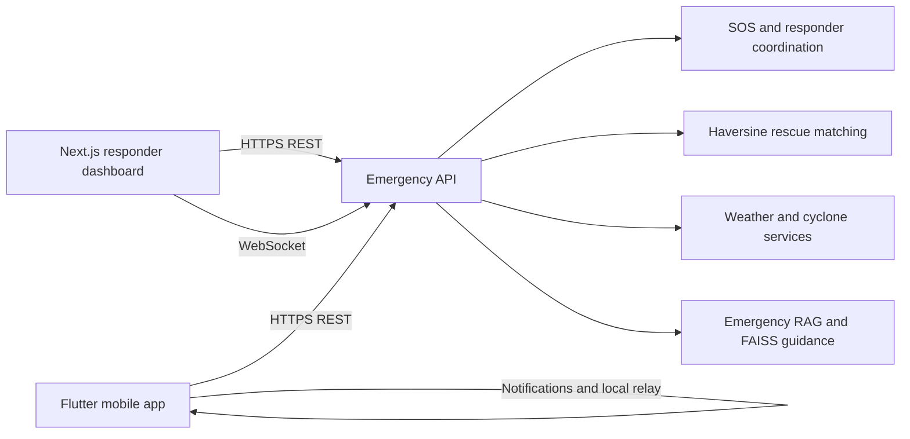

# Sahaya
Sahaya is an emergency coordination platform for disaster response. It combines live SOS dispatch, GPS-based rescue routing, cyclone and weather information, emergency guidance, and responder dashboards.
## Architecture



The repository is an npm/Turborepo workspace containing three applications:
| Component | Technology | Responsibility |
| --- | --- | --- |
| `apps/mobile` | Flutter, Dart | Citizen experience, GPS, weather alerts, SOS entry, and offline queuing |
| `apps/backend` | Next.js, React, Tailwind CSS | Real-time rescue responder command center |
| `apps/flask` | Flask/FastAPI, Python | Emergency APIs, SOS coordination, WebSocket dispatch, weather, cyclone, and RAG services |
Supporting data and assets are stored in `assets/`, `packages/`, and `cyclone_faq.faiss`.
## Core workflows
### SOS dispatch
1. The citizen app captures GPS coordinates and an emergency category.
2. The API creates an SOS record and ranks available rescue units by geographic distance.
3. The FastAPI realtime engine broadcasts the alert through `/ws/rescue` to eligible responders in the configured area.
4. A responder accepts the incident; the API records the assignment and broadcasts a status update.
5. Subsequent status changes are synchronized to connected clients.
### Offline operation
1. The mobile app stores SOS requests locally when network connectivity is unavailable.
2. When connectivity returns, queued records are sent in a batch to the API.
3. The backend deduplicates messages, rejects expired records, and registers new SOS events.
### Emergency guidance
The guidance service combines live cyclone context with retrieved documents in `cyclone_faq.faiss` and optional external AI services. Weather and cyclone integrations use provider credentials from environment variables.
> SOS records and WebSocket connections are currently maintained in process memory. Restarting the API clears active records and disconnects connected responders.
## Getting started
### Requirements
- Node.js 18+
- pnpm 8+
- Python 3.10+
- Flutter SDK
- A physical device or emulator for GPS and notification testing
### 1. Install the workspace
```bash
pnpm install
```
### 2. Configure the Python services
```bash
cd apps/flask
cp .env.example .env
python -m venv .venv
source .venv/bin/activate
pip install -r requirements.txt
```
Set the provider values in `apps/flask/.env` as needed:
```dotenv
GROQ_API_KEY=
GROQ_MODEL=qwen/qwen3.8-27b
WEATHERAPI_API_KEY=
GEMINI_API_KEY=
DTN_CLIENT_ID=
DTN_CLIENT_SECRET=
DTN_BASE_URL=https://tropical.api.dtn.com
DTN_AUTH_URL=https://api.auth.dtn.com/v1/tokens/authorize
```
For the realtime WebSocket and SOS API:
```bash
python fastapi_server.py
```
The service listens on `http://localhost:8080`.
For the Flask weather and legacy/SOS service used by the Docker setup:
```bash
python main.py
```
Alternatively, build and run the Flask container:
```bash
docker build -t sahaya-api apps/flask
docker run --env-file apps/flask/.env -p 8080:8080 sahaya-api
```
### 3. Start the responder dashboard
```bash
cd apps/backend
pnpm install
pnpm dev
```
Open `http://localhost:3000`. The dashboard connects to the realtime API at port `8080`.
### 4. Start the mobile app
Create `apps/mobile/.env` and add the API address for the development machine:
```dotenv
BACKEND_URL=http://<development-machine-ip>:8080
```
Then run:
```bash
cd apps/mobile
flutter pub get
flutter run
```
Update `apps/mobile/lib/core/constants.dart` for the current network address if a service does not read the environment override.
## Important API surfaces
| Area | Example |
| --- | --- |
| Create SOS | `POST /api/sos/create` |
| Active SOS list | `GET /api/sos/active` |
| Accept SOS | `POST /api/sos/{sos_id}/accept` |
| Update status | `POST /api/sos/{sos_id}/status` |
| Rescue teams | `GET /api/rescue/teams` |
| Nearby facilities or teams | `GET /api/rescue/nearby` or `POST /api/facilities/nearby` |
| Offline relay | `POST /api/offline/relay` |
| Emergency guidance | `GET /api/chat/emergency?query=<message>` |
| Cyclone data | `GET /api/cyclones/active` |
| Realtime channel | `ws://<host>:8080/ws/rescue?user_id=<id>&role=<role>&lat=<lat>&lng=<lng>` |
The FastAPI server exposes Swagger documentation at `http://localhost:8080/docs`.
## Development commands
| Scope | Command |
| --- | --- |
| All workspace development | `pnpm dev` |
| All workspace builds | `pnpm build` |
| All workspace lint checks | `pnpm lint` |
| Mobile checks | `cd apps/mobile && flutter analyze` |
| Mobile tests | `cd apps/mobile && flutter test` |
| Next.js dashboard | `cd apps/backend && pnpm dev` |
## Repository structure
```text
.
├── apps/
│   ├── backend/      # Next.js responder dashboard
│   ├── flask/        # Flask and FastAPI emergency services
│   └── mobile/       # Flutter citizen application
├── assets/           # Shared images and survey data
├── packages/         # Shared workspace UI and configuration
├── cyclone_faq.faiss # Emergency guidance retrieval index
└── turbo.json        # Workspace task configuration
```
## Operational notes
- Android emulator/device testing must use a reachable LAN or host address, not `localhost`.
- Location, notification, SMS, and network permissions are required for their corresponding features.
- Provider credentials are optional for parts of the application, but weather, AI guidance, and cyclone integrations will use fallbacks or limited data when unavailable.
- This project is designed for rescue and emergency use cases; validate real-world data sources and operational policies before production deployment.
